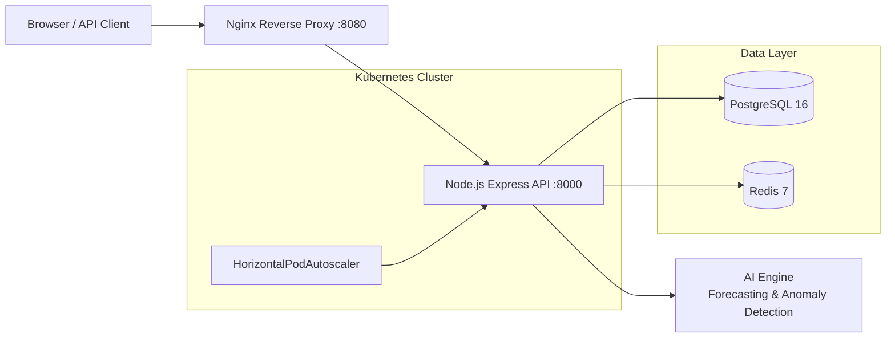

# Smart Inventory Manager

A security-hardened, production-ready inventory management platform with AI-powered demand forecasting, an immutable audit ledger, and full Kubernetes support. Built with Node.js, PostgreSQL, Redis, and Nginx.

## Architecture



## Features

- **Inventory CRUD** — Create, read, update, and soft-delete items with SKU tracking and category management.
- **AI Forecasting & Anomaly Detection** — Demand prediction and automatic low-stock alerts.
- **Immutable Audit Ledger** — SHA-256 hash-chained `transaction_logs` enforced by a PostgreSQL trigger; every stock change is permanently recorded.
- **QR Codes** — Generate HMAC-SHA256-signed QR codes per item; verify authenticity via `POST /api/qr/verify`.
- **Rate Limiting** — Redis-backed sliding-window rate limiter (100 req / 60 s per IP), fail-open on Redis outage.
- **Idempotency** — `Idempotency-Key` header support on POST/PATCH routes with 24-hour Redis-cached responses.
- **Cache-Aside** — Redis cache for catalog reads (`GET /api/items`, `GET /api/categories`) with automatic invalidation.
- **Health Probes** — Kubernetes-ready liveness and readiness endpoints.

## Quick Start

### Prerequisites

- Docker & Docker Compose
- (Optional) [k6](https://k6.io/) for load testing

### One-command setup

```bash
# Generates secrets, builds images, and starts all services
./scripts/setup-all.sh
```

### Manual setup

```bash
cp .env.example .env
# Edit .env with your secrets
docker compose up --build -d
# App available at http://localhost:8080
```

## Kubernetes Deployment

### Local cluster (Docker Desktop / Minikube / Kind)

```bash
./scripts/deploy-k8s.sh local 1.0.0
```

### Remote registry

```bash
./scripts/deploy-k8s.sh ghcr.io/your-user 1.0.0
```

The deployment applies all manifests in `k8s/` including namespace, ConfigMap, Secrets, NetworkPolicy, HPA, PDB, and TLS Ingress.

## API Endpoints

### Authentication (`/api/auth`)

| Method | Path | Description |
|--------|------|-------------|
| `GET` | `/api/auth/csrf` | Get CSRF token |
| `GET` | `/api/auth/status` | Session status |
| `POST` | `/api/auth/register` | Register a new user |
| `POST` | `/api/auth/login` | Log in (returns HttpOnly cookies) |
| `POST` | `/api/auth/refresh` | Refresh access token |
| `POST` | `/api/auth/logout` | Log out current session |
| `POST` | `/api/auth/logout-all` | Revoke all sessions |
| `GET` | `/api/auth/me` | Current user profile |
| `GET` | `/api/auth/users` | List users (admin only) |
| `POST` | `/api/auth/users` | Create user (admin only) |

### Inventory (`/api/items`)

| Method | Path | Description |
|--------|------|-------------|
| `GET` | `/api/items` | List all items (cached) |
| `POST` | `/api/items` | Create item |
| `GET` | `/api/items/:id` | Get single item |
| `PUT` | `/api/items/:id` | Update item |
| `DELETE` | `/api/items/:id` | Soft-delete item (admin only) |
| `POST` | `/api/items/:id/increment` | Increase stock |
| `POST` | `/api/items/:id/decrement` | Decrease stock (rejects on insufficient) |

### Categories (`/api/categories`)

| Method | Path | Description |
|--------|------|-------------|
| `GET` | `/api/categories` | List categories (cached) |
| `POST` | `/api/categories` | Create category |
| `DELETE` | `/api/categories/:id` | Delete category (admin only) |

### Analytics & Audit (`/api`)

| Method | Path | Description |
|--------|------|-------------|
| `GET` | `/api/analytics` | Dashboard analytics |
| `GET` | `/api/analytics/:id` | Per-item analytics |
| `GET` | `/api/alerts` | Active stock alerts |
| `GET` | `/api/transactions` | Transaction history |
| `POST` | `/api/check-stock` | Run stock check |
| `GET` | `/api/audit/verify` | Verify audit chain integrity |

### QR Codes (`/api/qr`)

| Method | Path | Description |
|--------|------|-------------|
| `GET` | `/api/qr/:id` | Generate signed QR code |
| `POST` | `/api/qr/verify` | Verify QR code signature |

## Health Probes

| Endpoint | Purpose | Auth Required |
|----------|---------|---------------|
| `GET /health/live` | Liveness — returns `200 OK` if the process is running | No |
| `GET /health/ready` | Readiness — returns `200 OK` only when PostgreSQL and Redis are reachable | No |

Both endpoints are used by the Kubernetes deployment (`k8s/backend.yaml`) for pod lifecycle management.

## Running Tests

### Concurrency test

Verifies that concurrent stock decrements never cause overselling (race condition safety):

```bash
node tests/concurrency-test.js
```

Environment variables: `API_URL`, `ADMIN_EMAIL`, `ADMIN_PASSWORD`.

### k6 load test

Runs 50 virtual users for 1 minute against the full API surface:

```bash
# Default (localhost:8080)
k6 run tests/load-test.js

# Custom target
k6 run -e BASE_URL=https://staging.example.com tests/load-test.js

# Custom credentials
k6 run -e ADMIN_EMAIL=user@example.com -e ADMIN_PASSWORD=secret tests/load-test.js
```

Thresholds: p95 latency < 500 ms, error rate < 10%.

## Benchmarks

| Metric | Before | After |
|--------|--------|-------|
| p95 Latency (ms) | — | — |
| RPS (req/sec) | — | — |
| Error Rate (%) | — | — |
| Max Concurrent Users | — | — |

> Run `k6 run tests/load-test.js` and fill in the results after each optimization pass.

## Security

| Layer | Control |
|-------|---------|
| **Passwords** | Argon2id (64 MiB, 3 iterations) + HMAC-SHA256 server pepper, constant-time dummy verification |
| **Sessions** | HttpOnly / SameSite=Strict cookies, 32-byte rotating refresh tokens stored as SHA-256 hashes, `crypto.timingSafeEqual` |
| **Audit Ledger** | SHA-256 hash-chained `transaction_logs`, PostgreSQL `BEFORE UPDATE OR DELETE` trigger prevents tampering, soft-deletes on items (`ON DELETE RESTRICT`) |
| **QR Codes** | HMAC-SHA256 signed payloads with server-side verification |
| **CSRF** | Double-submit cookie pattern with per-request token validation |
| **CSP** | `default-src 'self'; script-src 'self'; style-src 'self'` — zero inline scripts/styles, zero `innerHTML` |
| **Rate Limiting** | Redis sliding-window (100 req / 60 s per IP), fail-open |
| **Idempotency** | 24-hour cached responses keyed by `Idempotency-Key` header |
| **Kubernetes** | Restricted Pod Security, non-root UID, read-only root FS, dropped `ALL` capabilities, `RuntimeDefault` seccomp, default-deny NetworkPolicy, TLS Ingress |

## License

MIT
